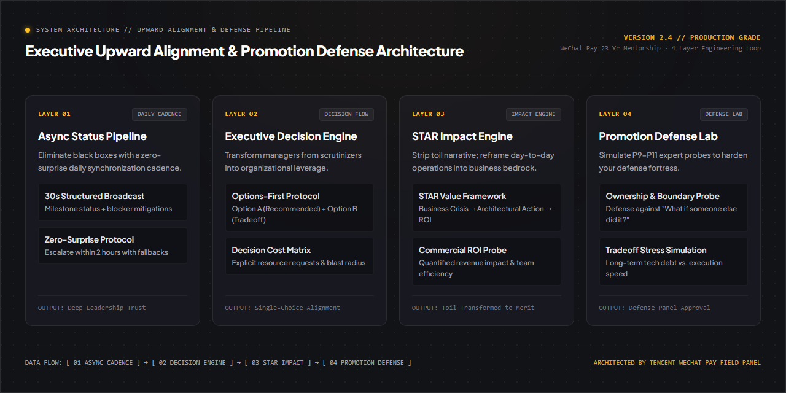

<div align="right">
  <a href="README_zh.md">简体中文</a> | <b>English</b>
</div>

<div align="center">


# Upward Communication Copilot & Promotion Defense Protocol
### Grounded in 23-year Tencent WeChat Pay senior product leadership & interviewer field practices

**Transform leadership into your highest-leverage business multiplier: master options-first alignment, 30s async broadcasts, and P9-P11 promotion defenses.**

<p align="center">
  <a href="https://github.com/Daokexun/upward-communication-copilot/stargazers"></a>
  <a href="LICENSE"></a>
  <a href="llms.txt"></a>
  <a href="cli/executive_brief_generator.py"></a>
  <a href="cheatsheets/communication_matrix.svg"></a>
  <a href="CONTRIBUTING.md"></a>
</p>

</div>

---

### 📖 Editorial Background

> **"The fundamental difference between mediocre and exceptional professionals: the former approaches leadership with question marks; the latter approaches leadership with options, recommendations, and quantified trade-offs."**  
> — kaka · 23-Year Tencent WeChat Pay Senior Lead & Interviewer

In high-growth tech organizations, engineering and product talent consistently suffer from three communication anti-patterns:

1. **The Passive Execution Trap**: Waiting for managers to check in, leading to micromanagement, anxiety, and surprise blockers.
2. **Problem-Dumping**: Reporting blockers as open-ended essay questions ("Upstream failed, what do we do?"), forcing leaders to do the cognitive heavy lifting.
3. **Toil-Only Promotion Narratives**: Framing performance around hours worked ("refactored legacy Python services") rather than commercial leverage, cross-team velocity multipliers, and defensible ROI.

This repository codifies the executive communication protocol used across Tier-1 BigTech leadership: **Options-First Decision Protocol, 30-Second Async Broadcasts, STAR Value Restructuring, and Calibration Committee Defense Wargames**.

---

### ⚡ Instant CLI Executive Brief Generator

Generate structured executive broadcast updates in under 15 seconds:

```bash
# 1. Clone repository
git clone https://github.com/Daokexun/upward-communication-copilot.git
cd upward-communication-copilot

# 2. Run instant comparative broadcast drill (Junior Panic vs. Executive Brief)
python cli/executive_brief_generator.py --generate-sample
```

---

### 🏛️ Four Core Pillars

| Pillar | Strategic Purpose | Core Execution Mechanism |
| :--- | :--- | :--- |
| **01 Options-First Decision Protocol**<br>`prompts/01_options_first_alignment.md` | Transform leaders from scrutinizers into organizational leverage | Replaces open-ended questions with Option A (Recommended) and Option B (Conservative trade-off). |
| **02 30-Second Async Progress Broadcast**<br>`prompts/02_async_progress_broadcast.md` | Eliminate information asymmetry with zero-surprise updates | 4-block status updates: Status Indicator + Business Metric + Decision Fork + Next Steps & DRI. |
| **03 STAR Business Impact Structuring**<br>`prompts/03_star_narrative_restructuring.md` | Purge maintenance toil and frame commercial value | Restructures complex backend refactoring into commercial foundation, latency wins, and cross-team velocity. |
| **04 Promotion Defense Wargame**<br>`prompts/04_promotion_defense_wargame.md` | Simulate P9-P11 expert panel cross-examination | Stress-tests scope, attribution ("What if someone else built this?"), architectural trade-offs, and technical debt. |

---

### 📐 System Architecture Matrix

The following diagram illustrates the 4-layer operational alignment matrix:

<div align="center">
  
</div>

---

### 🌲 Channel Selection Matrix & 1-Page Cheatsheet

Downloadable high-density printable vector artifacts for rapid review:
- 📄 **1-Page Cheat Sheet**: [`cheatsheets/executive_alignment_cheatsheet.md`](cheatsheets/executive_alignment_cheatsheet.md) (Channel selection matrix, STAR toil-to-merit restructuring)
- 📊 **Vector Alignment Matrix**: [`cheatsheets/communication_matrix.svg`](cheatsheets/communication_matrix.svg)

<div align="center">
  
</div>

---

### 🥊 Tactical Breakdown: Junior Panic vs. Executive Problem Solver

| Communication Context | Junior / Passive Anti-Pattern | Executive-Calibrated Protocol |
| :--- | :--- | :--- |
| **Project blocked by upstream dependency** | Panic dump: "The upstream team's API failed and our release is blocked. What should we do now?" | **Options-First Protocol**: "[AT RISK] Core checkout blocked by upstream auth API. We need decision authorization by 16:00 between two paths: **Option A (Recommended)**: Route traffic to backup auth gateway (zero customer downtime, +$450 cloud cost); **Option B (Conservative)**: Delay launch until upstream fixes by 20:00 (zero dollar cost, pushes launch 1 day). We recommend Option A to protect $1.2M launch GMV." |
| **Promotion calibration questioning** | "I worked 60 hours a week and solved all bugs assigned to me." | **Attribution & Multiplication**: "I recognized that fragmented caching caused 40% of peak-season outages. Beyond resolving tickets, I standardized the team-wide caching framework, which accelerated feature delivery across 3 sister teams by 3.2x while sustaining $45M in transactions with zero downtime." |

---

### 🤖 AI Coding Agent Integration (`llms.txt`)

This repository is optimized for autonomous coding agents (Claude Code, Cursor, GitHub Copilot).
- **Curated Rules**: Feed [`llms.txt`](llms.txt) to your AI agent to auto-format your daily standups into executive-grade 30-second briefs.
- **Full Specification**: Reference [`llms-full.txt`](llms-full.txt) for calibration defense rubrics.

---

### 📂 Repository Structure

```text
upward-communication-copilot/
├── assets/
│   ├── hero_poster_en.jpg           # Titanium English publication banner (1280x720)
│   ├── hero_poster_zh.jpg           # Chinese publication banner (1280x720)
│   ├── architecture.png             # 1280x640 High-Density Architecture Blueprint
│   └── architecture_zh.png          # 1280x640 Chinese Architecture Blueprint
├── cheatsheets/
│   ├── executive_alignment_cheatsheet.md # 1-page high-density quick reference
│   └── communication_matrix.svg     # Printable vector channel selection matrix
├── cli/
│   └── executive_brief_generator.py # Interactive CLI 30s Executive Brief Generator
├── prompts/
│   ├── 01_options_first_alignment.md      # Options-first decision protocol
│   ├── 02_async_progress_broadcast.md     # 30-second async progress broadcast
│   ├── 03_star_narrative_restructuring.md # STAR business impact restructuring
│   └── 04_promotion_defense_wargame.md    # Expert-level promotion defense wargame
├── templates/
│   └── executive_brief_schema.json  # 4-block executive brief validation schema
├── evals/
│   └── rubric_100_upward_alignment.json # 100-point upward management evaluation rubric
├── llms.txt                         # Curated AI Agent specification
├── llms-full.txt                    # Comprehensive specification
├── README.md                        # English documentation (current file)
└── README_zh.md                     # Chinese documentation
```

---

### 🌟 Star History & Community

<p align="center">
  <a href="https://star-history.com/#Daokexun/upward-communication-copilot&Date">
    
  </a>
</p>

### 📄 License & Community

This project is open-sourced under the [MIT License](LICENSE). Contributions from senior engineering managers, product leaders, and executive coaches are welcomed via [CONTRIBUTING.md](CONTRIBUTING.md).
