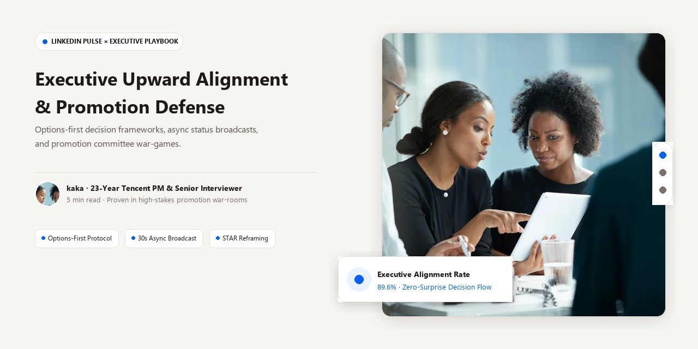

<div align="right">
  <a href="README_zh.md">简体中文</a> | <b>English</b>
</div>

<div align="center">



# Executive Upward Alignment & Promotion Defense Copilot
### Field-tested methodology distilled from 23-year Tencent PM and WeChat Pay senior interviewer kaka

**A strategic framework for options-first executive alignment, zero-surprise async reporting, and promotion defense.**

</div>

---

### 📖 Editorial Background

> **"Managing up is not about deference or office politics. It is about turning your manager into the most effective leverage point for strategic initiatives. Exceptional professionals never bring open-ended problems to leadership; they bring structured choices."**  
> — kaka (23-Year Tencent PM & WeChat Pay Senior Interviewer)

Across high-performance teams and technology enterprises, professionals regularly fall into three critical pitfalls:

1. **The Tactical Labor Trap**: Working relentless overtime to resolve operational emergencies, only to be evaluated during annual reviews as "a diligent executor who lacks strategic business ownership."
2. **The Chaotic Status Update**: When leadership asks for a progress update, delivering either an unedited 500-word stream-of-consciousness log or an opaque "everything is fine," leaving leaders blind to critical risks.
3. **The Promotion Committee Defense Failure**: When committee evaluators ask: *"What would have happened if someone else ran this project?"* or *"What did you uniquely own?"*, freezing and falling back on defensive effort-based rhetoric.

This system extracts field insights from 23-year Tencent product expert kaka to deliver **Options-First Decision Protocols, 30-Second Async Status Broadcasts, STAR Impact Restructuring, and Promotion Committee War-Games**.

---

### 🏛️ Four Core Pillars

Modeled after executive leadership editorial playbooks and asynchronous enterprise collaboration frameworks:

| Pillar | Strategic Purpose | Core Execution Mechanism |
| :--- | :--- | :--- |
| **01 Options-First Decision Protocol**<br>`prompts/01_options_first_decision_protocol.md` | Eliminate open-ended problem dumping onto leadership | Delivers: "Primary Recommendation + Viable Alternative + Resource Tradeoff", turning open questions into binary sign-offs. |
| **02 30-Second Async Status Broadcast**<br>`prompts/02_async_status_broadcast.md` | Establish zero-surprise visibility without micromanagement | Structures: "Core Milestones + Active Blockers + Contingency Mitigations + Specific Asks." |
| **03 STAR Impact Narrative Restructuring**<br>`prompts/03_star_narrative_restructuring.md` | Reframe tactical grind into boardroom business metrics | Formulates: "Macro Business Crisis Context $	o$ Architectural Tradeoff Action $	o$ Quantified Commercial Result." |
| **04 Promotion Committee Defense Simulator**<br>`prompts/04_p9_promotion_defense_simulator.md` | Defend high-stakes career promotion panels | War-games hostile committee lines of questioning: personal ownership, cross-team resistance, and core defensibility. |

---

### 📐 System Architecture

The following diagram illustrates the complete workflow from daily async updates to executive sign-offs and committee defense:

<div align="center">
  
</div>

---

### 🥊 Tactical Breakdown: Student Employee vs. Executive Alignment Veteran

| Workplace Situation | Amateur Approach | Executive Alignment Playbook |
| :--- | :--- | :--- |
| **Cross-team dependencies delay API delivery** | Complain to manager: "The other team isn't delivering on time; our project will slip." | **Frame Options & Request Targeted Leverage**: "Due to Team X's reorganization, joint testing is delayed by 5 days. I have prepared two contingency paths: **Option A (Recommended)**: Deploy a simulated mock server to unblock core checkout flows for launch on the 28th, requiring your alignment with Team X's director during Wednesday sync; **Option B**: Slip release to mid-next month. I recommend Option A to preserve Q3 momentum." |
| **Manager asks via chat: "What's the status?"** | Paste an unedited list of daily tasks and meetings attended. | **30-Second High-Density Broadcast**: "Core checkout integration is 100% complete with 8,500 TPS (exceeding target by 20%). Active blocker: sporadic latency spikes in risk checks (1.2% rate); fallback circuit-breaker is deployed with permanent patch scheduled for tomorrow 10:00 AM. Zero impact on Thursday release; no executive escalation needed." |
| **Promotion panel challenges: "Wasn't this outcome driven by market tailwinds rather than you?"** | Become defensive: "I worked weekends and holidays; the system would have collapsed without me." | **Causal Isolation & Counterfactual Defense**: "Market demand indeed grew 25%. However, our unique intervention was **reducing per-transaction compute cost by 38% and eliminating three catastrophic cascade points under 2x load**. Without this adaptive routing engine, server burn rate would have increased by \$250,000/month. That was the foundational business moat our team built." |

---

### 📂 Repository Structure

```text
upward-communication-copilot/
├── assets/
│   ├── hero_poster_en.jpg           # Dropbox-style English publication banner
│   ├── hero_poster_zh.jpg           # Chinese publication banner
│   ├── architecture.svg             # English vector architecture diagram
│   └── architecture_zh.svg          # Chinese vector architecture diagram
├── prompts/
│   ├── 01_options_first_decision_protocol.md # Options-first executive alignment workbench
│   ├── 02_async_status_broadcast.md          # 30-second async broadcast templates
│   ├── 03_star_narrative_restructuring.md    # Commercial STAR impact reframing engine
│   └── 04_p9_promotion_defense_simulator.md # High-stakes promotion panel war-game
├── templates/
│   └── upward_schema.json           # Structured decision and promotion data schema
├── evals/
│   └── rubric_100_upward.json       # 100-point defense and clarity evaluation rubric
├── docs/
│   └── ARCHITECTURE.md              # In-depth executive upward alignment whitepaper
├── examples/
│   └── SHOWCASE_COMPARISON.md       # Real-world promotion transcript before/after analysis
├── SKILL.md                         # Antigravity / Claude Agent Skill specification
├── README.md                        # English documentation (current file)
└── README_zh.md                     # Chinese documentation
```

---

### 🚀 Quickstart

```bash
# Clone the repository
git clone https://github.com/Daokexun/upward-communication-copilot.git

# Inspect the options-first decision framework
cat prompts/01_options_first_decision_protocol.md
```

---

### 📄 License & Community

This project is open-sourced under the [MIT License](LICENSE). Peer contributions from product leads, engineering managers, and executive coaches are welcomed via [CONTRIBUTING.md](CONTRIBUTING.md).
