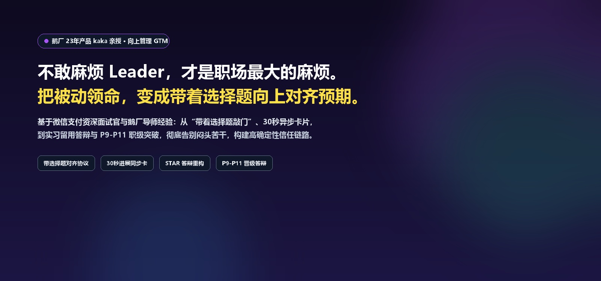

<p align="center">
  
</p>

<div align="center">

[English](README.md) • **简体中文**

[](LICENSE)
[](SKILL.md)
[](#-职场突围的三大-gtm-战略基石)
[](evals/rubric_100_upward.json)
[](CONTRIBUTING.md)

<p align="center">
  <b>职场新人最致命的陷阱，不是能力不够，而是“不敢麻烦 Leader、闭门造车闷头苦干”。</b><br>
  别再让黑盒焦虑摧毁你的职场信任。基于微信支付 23 年产品资深面试官 kaka 亲授实战心法，用“带选择题对齐协议、30秒异步卡片、STAR 降维提炼与答辩沙盘推演”，重构职场高确定性与晋升胜率。
</p>

[GTM 理念](#-什么是向上管理的-go-to-market-gtm-策略) • [三大战略基石](#-职场突围的三大-gtm-战略基石) • [四步落地路线](#-四步构建向上对齐与答辩高壁垒gtm-实施路线) • [实战真实对比](#-实战真实对比不敢找-leader-闷头苦干-vs-本工具高情商对齐方案) • [极速上手](#-30秒极速上手) • [系列架构](docs/ARCHITECTURE.md)

---

</div>

## 🎯 什么是向上管理的 Go-to-Market (GTM) 策略？

> **“Think of a go-to-market strategy as the north star that guides your product launch.”**  
> —— 亚马逊官方 GTM 指南

很多职场新人甚至老鹅，都有一个挥之不去的心理包袱：**“总觉得去找 Leader 汇报是打扰领导、暴露自己无能，能自己扛就自己硬扛。”**

结果呢？闷头搞了三周，最后拿出来的方案跟团队大战略南辕北辙，不仅自己委屈崩溃，Leader 也被吓出一身冷汗——错过了最佳救场时机。

**向上管理绝不是拍马屁，而是把你自己和你的项目作为交付物，向你最重要的内部客户（Leader 与业务评委）持续进行预期管理与价值交付的 GTM 过程：**
1. **摸透 Leader 的真实痛点（Understand Your Audience）**：Leader 怕的从来不是你问问题，Leader 最怕的是“信息黑盒”与“临期暴雷”。
2. **永远带着选项敲门（Understand the Decision Load）**：不要把空白问答题扔给领导，必须端出三套方案（A 稳妥/ B 突破/ C 折中）与量化利弊，帮 Leader 做 30 秒轻松决策。
3. **在关键节点建立极高确定性（Connect & Deliver）**：平时靠 30 秒卡片同步消除焦虑，答辩时靠严密的 STAR 决策复盘与底层机制沉淀赢下高票赞成。

**`upward-communication-copilot`** 将微信支付面试官 kaka 在腾讯内部辅导过数百名新人留用与 P9-P11 答辩的实战方法论，凝结成标准化 Agent 引擎。

---

## 🏛️ 职场突围的三大 GTM 战略基石

| 战略基石 | 核心操盘抓手 | 落地价值与产出 |
| :--- | :--- | :--- |
| **1. 降低领导决策负荷<br/>(Options-First)** | 严禁空白问答题，永远梳理 A（稳妥）、B（创新）、C（折中）三套方案并给明确倾向。 | Leader 决策时间由 30 分钟压降至 30 秒，瞬间建立“极其专业、善于思考”的信任印记。 |
| **2. 建立高确定性异步信使<br/>(Async Broadcast)** | 落实已闭环（Done）、推进中（WIP）、卡点求助（Blockers/Asks）三段式同步卡片。 | 彻底打破异地与远程办公的信息黑盒，让 Leader 随时掌握进度，前置化解风险。 |
| **3. 淬炼底层决策逻辑<br/>(STAR & Defense)** | 摆脱苦劳流水账，深挖极限约束下的关键抉择、失败反思与可复用机制。 | 实习生留用答辩与 P9-P11 职级答辩无死角通关，将寻常项目讲出顶尖产品哲学。 |

---

## 🔄 四步构建向上对齐与答辩高壁垒：GTM 实施路线

<p align="center">
  
</p>

### 📍 Step 1. 带选择题敲门 (Options-First Protocol)
- **方案 A（保底稳妥型）**：低风险、按部就班、收益确定。
- **方案 B（突破创新型）**：具备高杠杆，但需要一定试错预算与周期。
- **方案 C（低成本折中型）**：极端资源约束下的救急兜底。
- **给出个人专属倾向**：附带清晰数据与业务支撑，把领导从命题人变成裁判员。

### 📍 Step 2. 30秒异步进展同步 (Async Broadcast)
- **已交付产出 (Done)**：量化本周核心闭环价值。
- **明确卡点与指名求助 (Blockers & Asks)**：说明需要领导在哪个环节出面推一把，拒绝模糊抱怨。
- **风险前置预警**：提前 5 天暴露潜在延期苗头，把暴雷扼杀在萌芽中。

### 📍 Step 3. STAR 降维提炼工坊 (STAR Restructuring)
- **重构经历深度**：
  - Situation 渲染极限矛盾（多业务冲突、高并发、时间卡死）。
  - Task 明确硬核攻坚指标。
  - Action 讲透为什么放弃主流解法，如何通过架构/机制破局。
  - Result 展现跨团队复用沉淀。

### 📍 Step 4. 答辩与晋级沙盘推演 (Promotion Defense)
- **全真评委视角刁难质询**：模拟腾讯 P11+ 资深委员会专家提问。
- **100 分制向上管理与答辩成熟度审查**：低于 85 分自动强化反思与方法论提炼。

---

## 🥊 实战真实对比：不敢找 Leader 闷头苦干 vs 本工具高情商对齐方案

以一名在鹅厂核心业务线实习并准备留用答辩的同学为例：

| 场景 | ❌ 常见新人误区 (不敢麻烦 Leader / 闷头干) | 💎 本工具重构的高阶向上管理方案 (kaka 实战标准) |
| :--- | :--- | :--- |
| **遇到业务分歧** | “不敢去找 Leader，自己瞎猜需求，加了两周班做了个自认为很牛的功能，汇报时被批评偏离战略重心。”<br>*(❌ 浪费团队资源，加剧黑盒焦虑)* | **【带着三套选择题敲门】**<br>“Leader，关于该模块有 3 种解法：A 是低风险热修复，B 是彻底重构接口，C 是灰度降级。结合本季度上线时点，我建议采用 A 方案，同时下周前置测试 B 方案，您看如何？” |
| **周报与进度汇报** | “这周写了代码，改了几个 Bug，参加了组会，下周继续开发。”<br>*(❌ 流水账记仇簿，Leader 根本抓不住核心业务价值)* | **“📡 【30 秒高确定性卡片】”**<br>• 已交付：完成核心支付路由接口压测，P95 延迟压降 15ms；<br>• 卡点求助：需协调风控组提供沙盒测试数据，已提工单，请求 Leader 推进加急；<br>• 下周攻坚：完成全链路灰度 10% 放量。 |
| **留用与职级答辩** | “我在这三个月里做了很多杂活，每天加班到 10 点，代码提交了 500 次，非常热爱这个团队。”<br>*(❌ 用苦劳代替功劳，答辩委员会直接挂)* | **“🏆 【STAR 深度抉择与复盘】”**<br>重构为：在面临日均 3000 万请求高并发下，如何在零故障约束下主导完成冷热数据解耦；讲透技术抉择逻辑与沉淀的跨业务重试中间件，评委一致给全 A 评价。 |

---

## 🧠 微信支付资深面试官 kaka 的三大核心心法

### 1. 敢于麻烦 Leader 才是真正的成熟
Leader 的核心职责是为团队扫除障碍、调配资源。当你带着选择题来找 Leader，你不是在给他添麻烦，而是在帮他完成团队目标。

### 2. 确定性是职场最高级的溢价
能力强的人很多，但能让人“睡得着觉”的人很少。定期同步、不瞒报风险、言出必行，你就拥有了不可替代的信任资产。

### 3. 答辩展示的是你的思维天花板
千万不要陷入具体技术细节的自嗨。评委想看到的是你在复杂混沌的现实世界里，展现出的商业洞察、架构审美与复原反思。

---

## 📂 项目结构

```text
upward-communication-copilot/
├── SKILL.md                          # Antigravity Agent 技能主控规范
├── README.md                         # 英文官方文档 (English)
├── README_zh.md                      # 中文官方文档 (简体中文)
├── LICENSE                           # MIT 开源协议
├── CONTRIBUTING.md                   # 贡献指南
├── assets/                           # 商业海报与纯矢量架构图
│   ├── hero_poster_zh.jpg            # 中文版高质感商业海报
│   ├── hero_poster_en.jpg            # 英文版高质感商业海报
│   ├── architecture_zh.svg           # 中文四步法架构流程图
│   └── architecture.svg              # 英文四步法架构流程图
├── prompts/                          # 4 大模块化提示词资产工厂
│   ├── 01_options_first_protocol.md  # 带选择题敲门协议
│   ├── 02_async_blocker_broadcast.md # 30秒异步进展与求助卡片
│   ├── 03_star_restructuring_workshop.md # STAR 降维提炼工坊
│   └── 04_promotion_defense_simulator.md # 答辩与晋级沙盘推演
├── templates/                        # 结构化评估与模版
│   └── upward_schema.json            # 结构化输出 JSON Schema
├── evals/                            # 质量评估套件
│   └── rubric_100_upward.json        # 100 分制向上对齐评估模型
├── docs/                             # 技术架构与底层机制
│   └── ARCHITECTURE.md               # 核心架构文档
└── examples/                         # 实战对比与案例
    └── SHOWCASE_COMPARISON.md        # 闷头苦干 vs 高情商对齐残酷对比
```

---

## 🚀 30秒极速上手

### 在 Google Antigravity / Claude Agent 中直接调用
把本技能放入 `.agents/skills/upward-communication-copilot`，在对话中直接唤醒：

```text
/skill upward-communication-copilot
当前场景: 实习留用答辩 (或 向 Leader 汇报方案分歧)
业务背景: 微信支付/电商业务，面临新老系统兼容与灰度上线卡点
核心痛点: 方案有风险，不知道如何向 Leader 开口求助与做决策对齐
```

---

## 🤝 贡献与开源协议

欢迎提交 PR 与 Issue，共同扩充大厂答辩题库与向上管理对齐模板！  
本项目基于 [MIT License](LICENSE) 开源发布。
