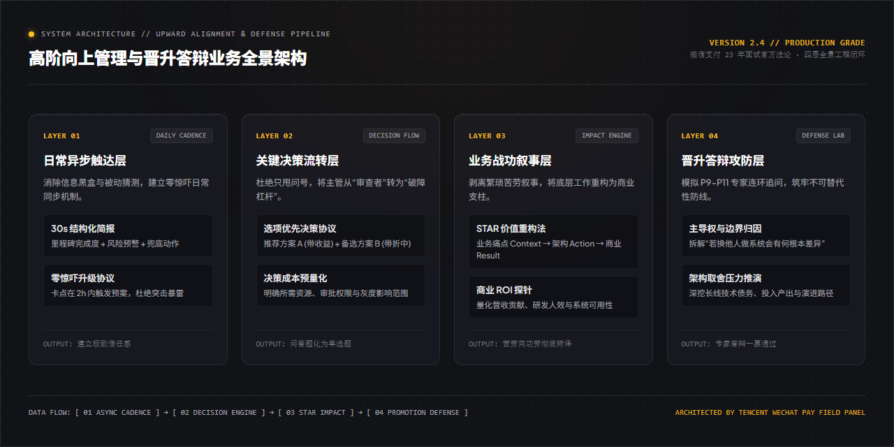

<div align="right">
  <b>简体中文</b> | <a href="README.md">English</a>
</div>

<div align="center">


# 高阶向上管理与晋升答辩实战指南
### Upward Communication Copilot & Promotion Defense Protocol

**沉淀自腾讯微信支付 23 年产品专家 & 资深面试官 kaka 实战方法论 · 把管理者转化为业务杠杆，掌握选项决策与晋升答辩**

<p align="center">
  <a href="https://github.com/Daokexun/upward-communication-copilot/stargazers"></a>
  <a href="LICENSE"></a>
  <a href="llms.txt"></a>
  <a href="cli/executive_brief_generator.py"></a>
  <a href="cheatsheets/communication_matrix.svg"></a>
  <a href="CONTRIBUTING.md"></a>
</p>

</div>

---

### 📖 导读与实战背景

> **“卓越员工与平庸员工最大的区别，在于前者永远带着选项找主管，后者永远带着问号找答案。”**  
> —— kaka · 腾讯微信支付 23 年产品专家 & 资深面试官（鹅厂卧谈会 EP13）

在互联网大厂与高成长组织中，技术与产品骨干普遍存在三大致命沟通盲区：

1. **“被动执行，被动猜测”**：从不主动同步进展，直到主管问起才汇报，极易引发微观管理与信任危机；
2. **“甩锅式提问”**：遇到卡点只甩出问号（“上游接口崩了，现在怎么办？”），逼迫主管做底层认知思考；
3. **“苦劳叙事，晋升折戟”**：答辩时通篇只讲“我加班干了多少活、改了多少代码”，缺乏不可替代性归因、商业 ROI 支撑与业务全局影响力。

本指南源于腾讯千亿级核心业务评审实战，系统沉淀**选项优先决策协议、30 秒异步简报机制、STAR 业务战功重构与专家级答辩攻防沙盘**，助力骨干员工实现跃迁。

---

### ⚡ 15 秒开箱实测 CLI

本地无需繁琐配置，终端直接体验高阶 30 秒异步简报对比生成：

```bash
# 1. 克隆代码仓库
git clone https://github.com/Daokexun/upward-communication-copilot.git
cd upward-communication-copilot

# 2. 运行对比评测：甩锅式提问 vs 选项优先高阶异步简报
python cli/executive_brief_generator.py --generate-sample
```

---

### 🏛️ 四大核心支柱 (Core Capabilities)

| 模块 | 核心解决问题 | 一线实战落地打法 |
| :--- | :--- | :--- |
| **01 选项优先决策协议**<br>`prompts/01_options_first_alignment.md` | 把主管从“审查者”转为“破障杠杆” | 坚决杜绝只甩问号，给出推荐方案 A (带收益) + 备选方案 B (带折中)，把问答题转化为单选题。 |
| **02 30 秒异步进度简报**<br>`prompts/02_async_progress_broadcast.md` | 消除信息黑盒，建立零惊吓日常同步 | 结构化 4 块呈现：状态红黄绿灯 + 商业指标影响 + 关键决策岔路口 + 下一步里程碑与负责人。 |
| **03 业务战功叙事 (STAR)**<br>`prompts/03_star_narrative_restructuring.md` | 剥离繁琐苦劳叙事，重构商业支柱 | 剥离底层琐碎运维，将系统优化重构为组织人效提升、商业护城河与万亿级支付高可用保障。 |
| **04 专家级晋升答辩沙盘**<br>`prompts/04_promotion_defense_wargame.md` | 模拟 P9-P11 专家连环高压追问 | 拆解“若换他人做系统会有何根本差异”、“技术选型权衡”、“长线技术债务归因”，筑牢不可替代性防线。 |

---

### 📐 业务全景系统架构

下图展示了日常触达、决策流转、价值叙事到答辩攻防的全景四层闭环：

<div align="center">
  
</div>

---

### 🌲 沟通通道决策矩阵与一页纸速查卡

配备高清可打印矢量图与速查清单：
- 📄 **一页纸核心速查卡**：[`cheatsheets/executive_alignment_cheatsheet.md`](cheatsheets/executive_alignment_cheatsheet.md)（通道决策矩阵、STAR苦劳向功劳转译）
- 📊 **矢量沟通决策矩阵**：[`cheatsheets/communication_matrix.svg`](cheatsheets/communication_matrix.svg)

<div align="center">
  
</div>

---

### 🥊 实战攻防对比：平庸员工 vs 高阶专业人才

| 沟通情境 | 平庸被动员工的做法 | 高阶专业人才的打法 |
| :--- | :--- | :--- |
| **项目遇到上游团队接口阻塞** | 甩锅焦虑：“上游接口今天突然挂了，我们的项目也卡住了，现在该怎么办？” | **选项优先协议**：“【预警】核心支付流受上游鉴权接口故障阻塞。需在 16:00 前决策：**方案 A (推荐)**：切至备用从属鉴权网关（用户零感知，产生约 $450 云网络成本）；**方案 B (保守)**：等待上游 20:00 修复热补丁（零金钱成本，但上线整体顺延 1 天）。建议执行方案 A 以保障 120 万日 GMV 按期开门红。” |
| **晋升答辩被问及项目贡献** | 苦劳陈述：“我连续加班 3 个月，每天干到 11 点，把老系统的几千行代码都重构了，写了很多单测。” | **战功叙事 (STAR)**：“我发现老旧缓存机制是引发大促故障的根源。我没有止步于修补 Bug，而是主导落地了团队级二级缓存框架，将兄弟团队的发版周期提速 3.2 倍（14天缩减至4.3天），平稳承载了 4500 万交易量零抖动。” |

---

### 🤖 AI Coding Agent 原生就绪 (`llms.txt`)

本项目全面适配 Claude Code、Cursor、GitHub Copilot 等 AI 编程助手：
- **精选上下文规则**：将 [`llms.txt`](llms.txt) 引入 Cursor 规则库，自动将你的工作日报转化为符合微信支付高管审美的高密度简报。
- **全量攻防规格**：参考 [`llms-full.txt`](llms-full.txt) 模拟 P9-P11 专家对你的晋升述职进行连环拷问。

---

### 📂 目录结构全览

```text
upward-communication-copilot/
├── assets/
│   ├── hero_poster_en.jpg           # 钛金机能英文技术封面海报 (1280x720)
│   ├── hero_poster_zh.jpg           # 中文技术封面海报 (1280x720)
│   ├── architecture.png             # 1280x640 全景钛金架构蓝图
│   └── architecture_zh.png          # 1280x640 中文架构蓝图
├── cheatsheets/
│   ├── executive_alignment_cheatsheet.md # 一页纸速查卡 (通道选择与STAR重构)
│   └── communication_matrix.svg     # 可打印矢量沟通通道决策矩阵
├── cli/
│   └── executive_brief_generator.py # 交互式 30 秒高阶异步简报生成工具
├── prompts/
│   ├── 01_options_first_alignment.md      # 选项优先决策协议
│   ├── 02_async_progress_broadcast.md     # 30秒异步进度简报
│   ├── 03_star_narrative_restructuring.md # 业务战功叙事 (STAR)
│   └── 04_promotion_defense_wargame.md    # 专家级晋升答辩沙盘
├── templates/
│   └── executive_brief_schema.json  # 4 块结构化异步简报校验 Schema
├── evals/
│   └── rubric_100_upward_alignment.json # 100 分制向上协同与晋升评鉴基准
├── llms.txt                         # AI Agent 规范
├── llms-full.txt                    # 完整规范
├── README.md                        # 英文说明文档
└── README_zh.md                     # 中文说明文档 (当前文件)
```

---

### 🌟 Star History & 社区

<p align="center">
  <a href="https://star-history.com/#Daokexun/upward-communication-copilot&Date">
    
  </a>
</p>

### 📄 开源许可证与贡献

本项目采用 [MIT License](LICENSE) 开源。欢迎各大厂产品专家、技术 Leader 及职场伙伴共同参与共建，详见 [CONTRIBUTING.md](CONTRIBUTING.md)。
